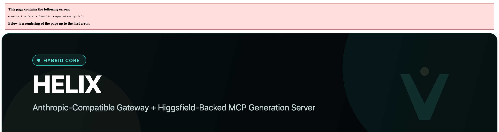
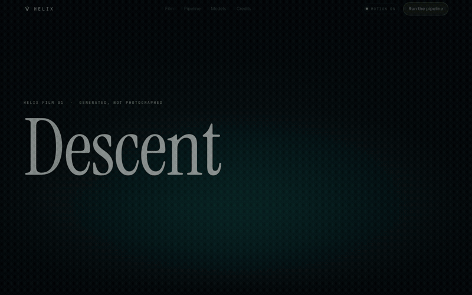
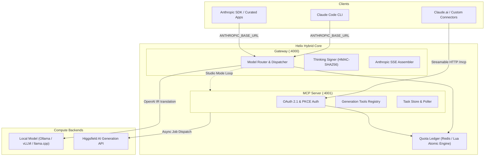
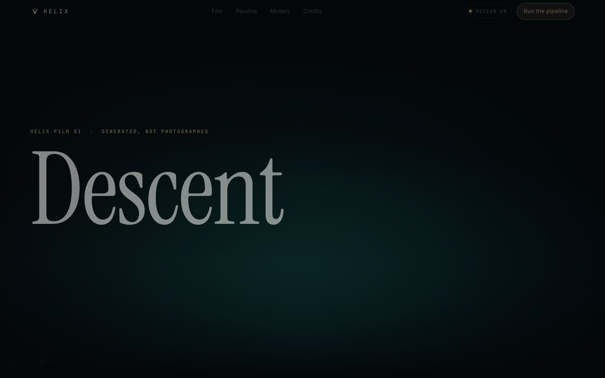
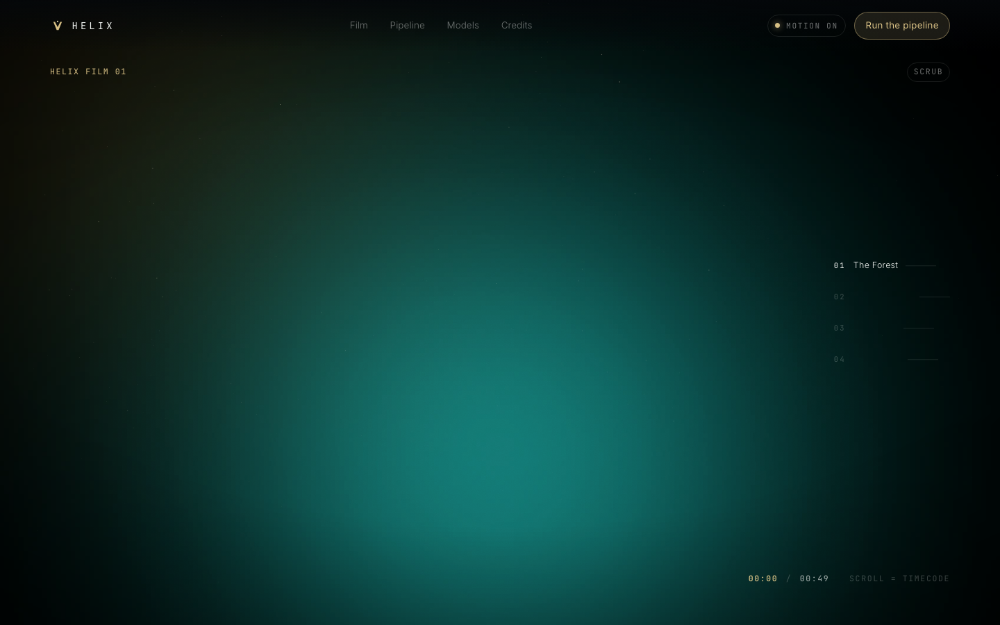
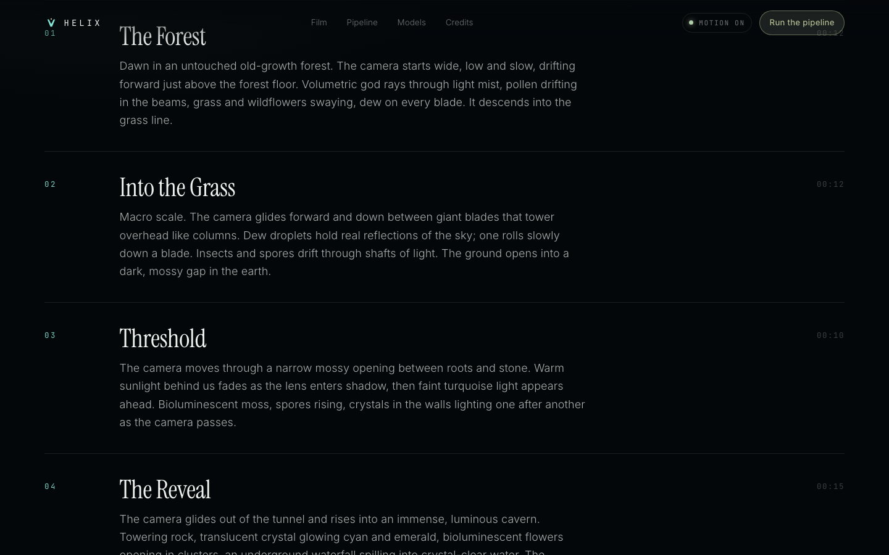
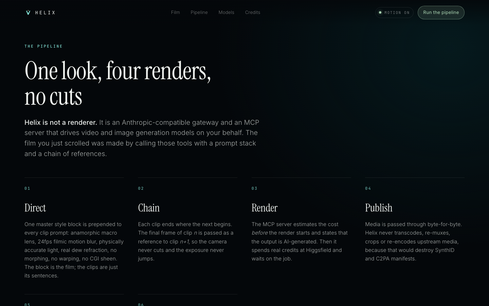

<div align="center">


# Helix

### Anthropic-Compatible Gateway &bull; Higgsfield-Backed MCP Generation Server

[](https://www.typescriptlang.org/)
[](https://nodejs.org/)
[](https://modelcontextprotocol.io/)
[](https://vitest.dev/)
[](https://www.docker.com/)
[](LICENSE)

<p align="center">
  <a href="#quick-start"><b>Quick Start</b></a> &bull;
  <a href="#architecture"><b>Architecture</b></a> &bull;
  <a href="#gateway-surface"><b>Gateway Surface</b></a> &bull;
  <a href="#mcp-generation-server"><b>MCP Server</b></a> &bull;
  <a href="#film-01-showcase"><b>Film 01 Showcase</b></a> &bull;
  <a href="#cli-reference"><b>CLI Reference</b></a>
</p>

</div>

---

<p align="center">
  
</p>

<p align="center">
  
</p>

---

## ⚡ What is Helix?

**Helix** unites local LLM intelligence with cloud-grade generative media production through two complementary surfaces:

1. **The Anthropic Gateway**: An endpoint implementing the full Anthropic Messages contract (`/v1/messages`). Point **Claude Code**, the **Anthropic TypeScript/Python SDK**, or **Claude.ai** at your local models (Ollama, vLLM, llama.cpp) with 100% wire fidelity—including streaming SSE events, reasoning tokens, tool calls, and synthetic thinking signatures.
2. **The Higgsfield MCP Server**: A Streamable HTTP Model Context Protocol server exposing Higgsfield's image and video generation engines (Seedance 2.5, Cinema Studio 4.0, DoP, Kling) directly to any MCP-compliant client with OAuth 2.1 authentication and atomic budget controls.
3. **Studio Mode (The Autonomous Loop)**: Configure your local LLM as an autonomous creative director. The gateway intercepts creative requests, offers Higgsfield MCP tools, dispatches generation jobs, monitors progress, and streams back the finished media seamlessly.

---

## 🌟 Key Highlights

- 🎯 **Drop-in Anthropic Wire Protocol**: Faithfully mirrors `POST /v1/messages` and `GET /v1/models`. Matches upstream error shapes, token-counting logic, cache-breakpoint tracking, and SSE frame ordering (`message_start`, `content_block_delta`, `message_delta`, `message_stop`).
- 🎬 **Dual-Era MCP Generation**: Automatically negotiates modern `2026-07-28` (stateless, `resultType`, TTL cache scopes) and classic `2025-11-25` MCP protocol handshakes.
- 🛡️ **Atomic Quota & Spend Guards**: Real-time RPM rate limiting and daily USD spend ceilings powered by atomic Redis Lua scripts, failing gracefully to in-memory ledgers.
- 🔐 **OAuth 2.1 + RFC 9728 Compliance**: Built-in authorization code flow with PKCE, dynamic client registration, and token rotation tailored for Claude Custom Connectors.
- 🎥 **Descent — Film 01 Showcase**: Complete zero-build scroll-driven interactive landing site (`site/`) built for frame-accurate scrubbing across 49 seconds of chained AI cinematography.
- 🧪 **Rock-Solid Engineering**: 401 unit, integration, and socket-level end-to-end test cases with **91.03% statement test coverage**.

---

## 🏛️ Architecture



---

## 🖼️ Feature Gallery

<table width="100%">
  <tr>
    <td width="50%" align="center">
      
      <br />
      <b>Descent — Film 01 Hero Experience</b>
      <p><i>49-second continuous AI-generated take from dawn forest to bioluminescent cavern.</i></p>
    </td>
    <td width="50%" align="center">
      
      <br />
      <b>Frame-Accurate Scroll Scrubber</b>
      <p><i>Smooth scroll-position mapping with adaptive acceleration and ambient particle overlay.</i></p>
    </td>
  </tr>
  <tr>
    <td width="50%" align="center">
      
      <br />
      <b>Autonomous Prompt Chaining</b>
      <p><i>Master style prompts and frame-to-frame continuity chaining between clips.</i></p>
    </td>
    <td width="50%" align="center">
      
      <br />
      <b>Integrated Production Pipeline</b>
      <p><i>Full diagnostic pipeline view linking local model inference with MCP render workers.</i></p>
    </td>
  </tr>
</table>

---

## 🚀 Quick Start

### 1. Prerequisites

- **Node.js**: `v20.0.0` or higher (Node 22 / 24 recommended)
- **Package Manager**: `pnpm >= 9`
- **Optional**: [Ollama](https://ollama.com/) (running locally) & [Redis](https://redis.io/) (for shared quotas)

### 2. Installation & Setup

```bash
# Clone the repository
git clone https://github.com/satiricalguru/Helix.git
cd Helix

# Install monorepo dependencies
pnpm install

# Copy environment template
cp .env.example .env

# Build all TypeScript packages
pnpm build
```

### 3. Run Environment Doctor

Verify connectivity to your local model, Redis, and Higgsfield credentials:

```bash
pnpm doctor
```

Output:
```text
Helix doctor
────────────────────────────────────────────────────────────
local model   http://127.0.0.1:11434/v1 (qwen3:32b) ... ok
  available: llama3.2:3b, nomic-embed-text:latest, ornith-1.5:9b
higgsfield   the credential was accepted
redis        ok
────────────────────────────────────────────────────────────
served model: helix-fable-5-2
upstream:     qwen3:32b
generation:   14 models in the catalog

all checks passed
```

### 4. Start the Services

In separate terminal sessions or background processes:

```bash
# Start the Anthropic Gateway (Port 4000)
pnpm dev:gateway

# Start the Higgsfield MCP Server (Port 4001)
pnpm dev:mcp
```

Or run everything with **Docker Compose**:

```bash
docker compose up -d
```

---

## 🔌 Connecting Your Clients

### Claude Code CLI

Direct Claude Code to use your Helix Gateway as its LLM backend:

```bash
export ANTHROPIC_BASE_URL="http://127.0.0.1:4000"
export ANTHROPIC_API_KEY="sk-helix-..." # printed on gateway boot, or set HELIX_API_KEY
claude --model helix-fable-5-2
```

Add the Helix MCP Generation tools to Claude Code:

```bash
claude mcp add --transport http helix http://127.0.0.1:4001/mcp
claude mcp login helix
```

### Claude.ai Custom Connector

1. Open **Claude.ai** &rarr; **Settings** &rarr; **Connectors** &rarr; **Add Custom Connector**.
2. **Name**: `Helix`
3. **URL**: `https://<your-host>:4001/mcp`
4. Complete the OAuth 2.1 login flow in your browser.

---

## 🛠️ MCP Tools Catalog

Helix exposes generation tools with embedded pricing disclosure and AI content metadata:

| Tool | Mode | Description | Cost Model |
| :--- | :---: | :--- | :--- |
| `list_generation_models` | Read-only | Returns available video/image models, supported resolutions, and limits | Free |
| `get_generation_model` | Read-only | Detailed schema, parameter limits, and provider terms for a specific model | Free |
| `generate_video` | Action | Dispatches video generation (Seedance, Cinema Studio, Kling) and waits for output | Quoted per second |
| `generate_image` | Action | Dispatches high-resolution image generation from prompts and references | Quoted per image |
| `get_generation_status` | Read-only | Inspects asynchronous generation request progress and artifact URLs | Free |
| `estimate_generation_cost` | Read-only | Pre-flight pricing calculations before invoking paid pipelines | Free |
| `balance` | Read-only | Reports current account credits and subscription tier | Free |
| `show_plans_and_credits` | Read-only | Displays plan details and upgrade links | Free |

---

## 💻 CLI Commands

The `@helix/cli` provides first-class developer tooling:

```bash
# Run environment diagnostics
pnpm cli doctor

# Inspect available served models and the generation catalog
pnpm cli models

# Mint a new virtual API key with custom rate limits and daily USD budget
HELIX_KEY_LABEL="prod-app" HELIX_MEDIA_BUDGET_USD=25 pnpm cli key

# Provision an MCP user account
pnpm cli user admin@helix.local MySecurePassword123
```

---

## 📦 Monorepo Structure

```text
Helix/
├── apps/
│   └── cli/             # Helix developer CLI tool (@helix/cli)
├── packages/
│   ├── config/          # Static catalogs, model deployments & pricing specs
│   ├── contracts/       # Anthropic API & MCP protocol schemas & Zod validators
│   ├── gateway/         # Anthropic-compatible HTTP/SSE server & router
│   ├── hf-client/       # Resilient Higgsfield asynchronous API client
│   ├── local-adapter/   # OpenAI-to-Anthropic stream assembler & thinking signer
│   ├── mcp-client/      # Reconnecting client for MCP generation endpoints
│   ├── mcp-server/      # Dual-era Streamable HTTP MCP & OAuth 2.1 server
│   └── quota/           # Atomic Redis Lua quota service & in-memory fallbacks
├── site/                # Descent (Film 01) zero-build interactive landing page
├── scripts/             # Production scripts for video rendering & auth probes
├── docker/              # Dockerfiles for Gateway and MCP Server
└── test/                # Socket-level end-to-end verification suite
```

---

## 🧪 Testing & Verification

Helix maintains rigorous automated testing with Vitest and v8 coverage:

```bash
# Run the complete test suite (401 tests across 24 suites)
pnpm test

# Run tests with detailed coverage report
pnpm test:coverage

# Perform typecheck across all workspaces
pnpm typecheck
```

---

## 📄 License

Distributed under the **MIT License**. See `LICENSE` for more information.

<div align="center">
  <br />
  <p><sub>Built with precision for autonomous creative intelligence.</sub></p>
  <a href="#helix"><b>&uarr; Back to Top</b></a>
</div>
